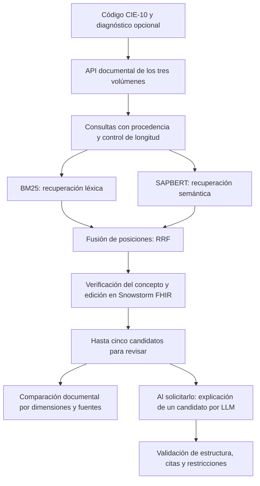

# CIE-10 → SNOMED CT

Plataforma de investigación para explorar candidatos SNOMED CT a partir de un código CIE-10 y, opcionalmente, un diagnóstico escrito. Reúne el contexto documental de CIE-10, recuperación léxica y semántica, comparación con fuentes y explicaciones generadas bajo demanda.

El código está organizado para estudiar cómo se recuperan los candidatos y qué evidencia respalda su revisión. No realiza una conversión clínica definitiva ni representa un mapa oficial de equivalencias.

## Por qué existe

Los diagnósticos registrados en CIE-10 forman parte de la información histórica de salud. El proyecto estudia cómo vincular esa información con SNOMED CT, una terminología de mayor detalle para el registro clínico y la interoperabilidad semántica.

En Chile, la arquitectura de interoperabilidad de MINSAL contempla SNOMED CT como terminología de referencia para los registros clínicos electrónicos, según los casos de uso. Conectar los registros previos con ese entorno busca contribuir a la continuidad de la atención.

La dirección CIE-10 → SNOMED CT parte de lo que ya está registrado. El mapa oficial en la dirección SNOMED CT → CIE-10 tiene otro propósito y no se puede invertir suponiendo equivalencias únicas.

## El problema del mapeo

Una categoría CIE-10 puede corresponder a varios conceptos SNOMED CT, con diferencias de localización, subtipo, estadio o calificadores. Esa relación **1:N** no implica que todos los candidatos sean equivalentes.

El título de un código puede ser insuficiente para distinguirlos. Sus inclusiones, exclusiones y reglas amplían el contexto; el diagnóstico opcional puede aportar detalles del caso. El sistema permite revisar qué coincide y qué información se añade, se omite o necesita aclaración.

## Preprocesamiento de CIE-10

Se trabaja con los tres volúmenes de la edición española OPS/OMS de **2018**, obtenidos de las fuentes oficiales utilizadas en Chile.

| Volumen | Contenido recuperado | Sección de la API |
| --- | --- | --- |
| 1. Lista tabular | Códigos, títulos, jerarquía, inclusiones, exclusiones, notas e instrucciones; alcance y herencia documental. | `classification`, `tabular` |
| 2. Manual de instrucciones | Unidades de lectura, reglas, ejemplos y tablas; distinción entre morbilidad, mortalidad y condiciones de aplicación. | `manual_context` |
| 3. Índice alfabético | Rutas de términos, subentradas, continuaciones, tablas y remisiones, conservando columnas, símbolos y destinos. | `index_context` |

La extracción utiliza texto y geometría del PDF para reconstruir líneas partidas, sangrías, llaves y relaciones. Los registros conservan la página, ubicación y huella de la fuente. Las ambigüedades documentales permanecen identificadas.

Los datos intermedios se guardan como **JSONL**. Una compilación **SQLite** permite consultarlos por código y ámbito. La API devuelve una vista legible y otra de evidencia más detallada, con paginación y referencias.

Además de las secciones anteriores, la respuesta incluye `shared_context` y `general_conventions` para interpretar las fuentes, y `quality` para su procedencia y límites. Una ruta del índice orienta la consulta; no se convierte automáticamente en un sinónimo.

## Flujo de consulta



La interfaz permite consultar el contexto CIE-10, contrastar candidatos, inspeccionar sus fuentes y abrir los JSON CIE-10 o FHIR en pestañas independientes. Incluye un tutorial y páginas que explican el proyecto, el preprocesamiento, la búsqueda y los modelos.

## Búsqueda de candidatos

**BM25** utiliza las palabras de la consulta sobre SQLite FTS5. Es una señal léxica que pondera la frecuencia de los términos, su rareza y la longitud de las descripciones.

**SAPBERT** representa las consultas y las descripciones como vectores para recuperar términos semánticamente próximos. La configuración actual utiliza [`BSC-NLP4BIA/SapBERT-from-roberta-base-biomedical-clinical-es`](https://huggingface.co/BSC-NLP4BIA/SapBERT-from-roberta-base-biomedical-clinical-es), con revisión fijada. Su dominio biomédico y clínico en español motiva su elección. La similitud vectorial recupera candidatos; no establece equivalencia clínica.

Los resultados se combinan mediante **Reciprocal Rank Fusion (RRF)**. En esta implementación se conserva la mejor posición de cada concepto en cada método y se aplica:

$$s(c)=\frac{0.5}{60+r_{\text{léxico}}(c)}+\frac{0.5}{60+r_{\text{semántico}}(c)}$$

Un método sin resultado para el concepto no aporta ese sumando. La puntuación no es una probabilidad. Con diagnóstico elegible, un cross-encoder opcional puede reordenar el mismo conjunto; las posiciones originales siguen disponibles.

## SNOMED CT y Snowstorm

Snowstorm es el **servidor terminológico** que expone el contenido SNOMED CT importado desde archivos RF2. Su interfaz FHIR permite comprobar el identificador, la actividad, las descripciones, los atributos y las relaciones de un concepto en una edición concreta.

La búsqueda utiliza un índice local de descripciones españolas y vectores. Snowstorm se usa para verificar y ampliar la información terminológica de los conceptos recuperados. Ambos consultan la misma versión; cumplen funciones diferentes.

La configuración publicada fija la edición española **2026-11-10**, compuesta con su dependencia internacional **2026-10-01**. No se debe sustituir esa base por una edición internacional más reciente sin revisar la dependencia declarada en RF2 y los enlaces de versión del código.

## Comparación y explicaciones

**Comparación** organiza las dimensiones pertinentes: afección, enfermedad asociada, estadio, inicio, calificadores y localización. Muestra las fuentes de cada punto y separa el contexto de codificación y los atributos de apoyo. Sus textos son mensajes predefinidos elegidos por comprobaciones documentales; no son una respuesta de un LLM. Las diferencias de palabras sin relación verificada quedan pendientes de revisión.

**Explicación** solicita al modelo elegido un análisis de un candidato. Recibe evidencia seleccionada de CIE-10, descripciones y atributos SNOMED y el diagnóstico opcional. Debe explicar coincidencias, diferencias y detalles faltantes, con referencias vinculadas a sus afirmaciones.

- **Modelo local:** Gemma 3 4B con `llama.cpp`, cargado bajo demanda. Permite trabajar con recursos propios; su capacidad y consistencia son limitadas.
- **API externa / BYOK:** permite usar una clave propia de la instancia. El conector actual es OpenAI; la clave se configura en el servidor y no se entrega al navegador. El envío necesita consentimiento en la interfaz y consume saldo de API.
- **Validación:** comprueba formato, fuentes, citas y restricciones implementadas. No demuestra por sí misma que todo el razonamiento sea semánticamente correcto.
- **Recuperación local:** ante fallos, el último intento puede generar una comparación acotada a términos y contexto SNOMED. Se identifica en pantalla y no propone una selección automática.

Las explicaciones se mantienen en memoria durante la consulta; no se guardan como historial. Una generación fallida no se sustituye por una justificación preescrita. La plataforma permite consultar la evidencia disponible.

## Organización del repositorio

```text
cie10/                 Procesamiento documental, API, recuperación y comparación.
  reasoning/           Análisis de afirmaciones, negación, alcance y restricciones.
config/                Fuentes, revisiones documentales y especificaciones de modelos.
frontend/              Interfaz Nuxt + Nuxt UI y rutas de servidor que llaman a Python.
  app/components/      Consulta, comparación, explicaciones, fuentes y tutorial.
  app/pages/           Consulta y páginas explicativas del proyecto.
  server/api/          Puente HTTP con los servicios locales y vistas JSON.
infra/                 Configuración de Snowstorm y preparación de modelos.
scripts/               Preparación, configuración y puntos de entrada de la plataforma.
tests/                 Pruebas unitarias y controles documentales.
docs/                  Instalación y guía de lectura del código.
```

Empieza por la [guía del código](docs/code-guide.md) para seguir una petición entre archivos. Algunas tablas JSON de `cie10/` y el registro de revisión de `config/` forman parte de la normalización documental; se conservan porque el parser las utiliza.

## Instalación y ejecución

El entorno de referencia es **Linux / Ubuntu WSL**, con Python **3.14**, Node.js **24**, Docker y, para la recuperación semántica y el generador local actuales, una GPU NVIDIA compatible con CUDA. Los servicios se enlazan a la interfaz local.

Los módulos de `cie10/` separan la ejecución de consultas, el razonamiento documental y la preparación de fuentes. `scripts/` contiene los puntos de entrada necesarios para operar o preparar la plataforma; `tests/` conserva sus verificaciones. Los experimentos históricos y las herramientas piloto quedan fuera.

Consulta la [guía de instalación](docs/installation.md). Allí se explica cómo preparar los PDF, importar SNOMED CT, construir los índices, configurar los modelos e iniciar los servicios. El frontend puede inspeccionarse sin los datos; las consultas necesitan los servicios y catálogos preparados.

## Pruebas

Las pruebas unitarias no requieren una clave externa ni realizan llamadas de pago:

```bash
python3 -m unittest discover -s tests
python3 scripts/check_reasoning.py
```

Las comprobaciones que necesitan corpus locales se omiten cuando estos no están disponibles. Los informes experimentales históricos no forman parte de esta publicación.

## Referencias

- [MINSAL: estándares y perfiles de interoperabilidad](https://interoperabilidad.minsal.cl/docs/especificacion-de-la-arquitectura/estandares-perfiles.html).
- [SNOMED International: mapeo desde otros sistemas](https://docs.snomed.org/snomed-ct-practical-guides/snomed-ct-data-analytics-guide/5-preparing-data-for-analytics/5.2-mapping-other-code-systems-to-snomed-ct).
- [Snowstorm](https://github.com/IHTSDO/snowstorm).
- [SAPBERT](https://aclanthology.org/2021.naacl-main.334/).

## Licencia y contacto

Código bajo [Apache License 2.0](LICENSE).
